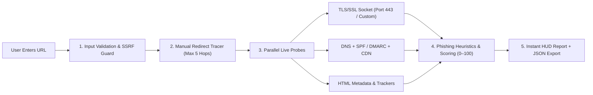

# VERITAS // LENS

**Independent, Zero-Login Website Security & Phishing Intelligence Scanner**

[](https://nextjs.org/)
[](https://www.typescriptlang.org/)
[](https://tailwindcss.com/)
[-2f855a?style=flat-square)](#privacy--architecture)

**VERITAS // LENS** lets you inspect any website URL before you trust or click it. Paste a link to immediately see its **0–100 Security Rating (Grade A+ to F)** and **Phishing Detection Verdict** at the top, followed by live TLS/SSL, DNS, HTTP security header, redirect, and tech-stack telemetry.

No sign-in. No database. No tracking cookies. Your recent scans stay solely in your browser's `localStorage`.

---

## How It Works

When you submit a URL, the Next.js server executes a multi-stage, SSRF-hardened inspection pipeline and returns a deterministic JSON report:



### Step-by-Step Pipeline

1. **Input Validation & SSRF Guard (`src/lib/security.ts`)**
   - Validates the URL with Zod and restricts protocols strictly to `http:` and `https:`.
   - Rejects embedded credentials (`user:pass@host`), `localhost`, `.local`, and `.internal` domains.
   - Resolves DNS **before** connecting and blocks all private, loopback (`127.0.0.0/8`, `::1`), link-local / cloud metadata (`169.254.0.0/16`), and reserved IPv4/IPv6 ranges.

2. **Redirect Chain Tracer (`src/lib/scanner.ts`)**
   - Follows up to 5 HTTP redirects manually (`redirect: "manual"`), re-running SSRF validation on every single redirect hop and measuring total response latency.

3. **Live TLS / SSL Inspection**
   - Opens a direct `node:tls` socket to inspect the peer certificate, TLS protocol version (`TLSv1.3` / `TLSv1.2`), cipher suite, issuer, validity window, and days remaining.

4. **DNS, Email Spoofing & Infrastructure Audit**
   - Queries live `IPv4`, `IPv6`, `MX`, `NS`, and `TXT` records.
   - Checks for **SPF (`v=spf1`)** and **DMARC (`_dmarc`)** anti-spoofing policies and fingerprints CDNs/WAFs (Cloudflare, AWS CloudFront, Vercel Edge, Netlify, Akamai, Fastly).

5. **HTTP Security Headers & HTML Intelligence**
   - Audits 6 browser security headers: `Strict-Transport-Security`, `Content-Security-Policy`, `X-Frame-Options`, `X-Content-Type-Options`, `Referrer-Policy`, and `Permissions-Policy`.
   - Safely parses up to 512 KB of HTML (without executing scripts) to extract `<title>`, `<meta name="description">`, canonical URL, frameworks/servers, third-party trackers, external link counts, and `<input type="password">` forms.

6. **Phishing Heuristics & Deterministic Scoring**
   - Flags IDN punycode (`xn--`), homoglyph brand impersonation (e.g., `paypa1` vs `paypal`), high-abuse TLDs (`.tk`, `.ml`, `.xyz`, `.click`, etc.), raw IP hosts, URL shorteners, deep subdomain nesting, credential-harvesting URL keywords, and password forms on flagged hosts.
   - Computes a transparent `0–100` score with exact point deductions mapped to Grades `A+` through `F` and Verdicts (`Safe`, `Caution`, `High Risk`).

---

## Features

- **Top-Level Security Gauge & Phishing Verdict** — Animated SVG radial gauge (`0–100`) with immediate phishing & threat heuristic breakdown.
- **Interactive Phishing URL Anatomy Lab** — Clickable URL breakdown on the home page showing how attackers disguise links and how each segment is scored.
- **Interactive Capabilities Explorer** — Detailed breakdown of all 6 inspection modules right from the landing page.
- **Interactive Canvas Backdrop** — Mouse-reactive HTML5 `<canvas>` particle constellation in a natural charcoal, alabaster, copper, and sage palette.
- **Browser-Local History & JSON Export** — Re-open recent scans from `localStorage` or download full reports as `.json`.

---

## Security Hardening

- **SSRF Protection:** Blocks private/internal IPs and re-validates every redirect hop.
- **Rate Limiting:** Sliding-window IP rate limiter on `/api/scan` (`15 requests/minute` per IP) returning `429 Too Many Requests` with `Retry-After`.
- **Hardened HTTP Headers (`next.config.ts`):** `Content-Security-Policy`, `X-Frame-Options: DENY`, `X-Content-Type-Options: nosniff`, `Referrer-Policy`, `Permissions-Policy`, `Strict-Transport-Security`, `COOP`, `CORP`, and `X-Powered-By` disabled.
- **XSS Prevention:** Strict Zod input validation, control-character sanitization, and zero `dangerouslySetInnerHTML`.

---

## Getting Started

```bash
# 1. Install dependencies
npm install

# 2. Start the development server
npm run dev
```

Open [http://localhost:3000](http://localhost:3000) in your browser.

### Production Build

```bash
npm run lint
npm run build
npm run start
```

---

## Project Structure

```text
src/
├── app/
│   ├── api/scan/route.ts       # Rate-limited POST /api/scan endpoint
│   ├── globals.css             # Warm charcoal/copper theme & surface styles
│   ├── layout.tsx              # Space Grotesk, Plus Jakarta Sans & IBM Plex Mono
│   └── page.tsx                # Home page entry
├── components/
│   ├── InteractiveField.tsx    # Mouse-reactive HTML5 canvas constellation
│   ├── ScannerWorkspace.tsx    # Main scanner UI, Phishing Lab & Capabilities Explorer
│   └── SecurityGauge.tsx       # Animated SVG radial security score gauge
└── lib/
    ├── env.ts                  # Optional server-side environment config
    ├── rate-limit.ts           # In-memory sliding-window rate limiter
    ├── scanner.ts              # TLS, DNS, HTTP headers, HTML & phishing engine
    └── security.ts             # URL validation, SSRF IP guard & text sanitization
```

---

**Made by Himanshu Singh using Next.js**
